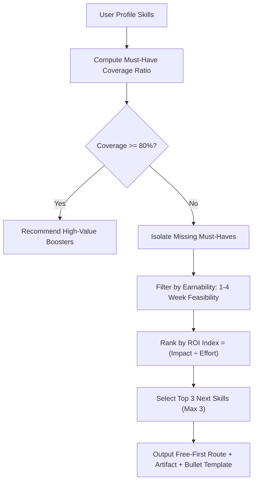

# Skill — Naukri Profile Optimizer

**Purpose:** Definitive domain taxonomy, skill competency architecture, keyword intelligence mapping, certification value models, and gap-radar specifications for "Naukri Profile Optimizer". Organised as the authoritative standard referenced by the deterministic parsing, scoring, bullet-rewriting, job-fit matching, and action-planning engines.

---

## 1. How This Document Is Used

Three distinct system consumers depend directly on the taxonomy defined here:

```
┌────────────────────────────────────────────────────────────────────────┐
│                        SKILL TAXONOMY CONSUMERS                        │
├─────────────────┬──────────────────────────────────────────────────────┤
│ 1. ENGINE       │ `lib/data/skills-dict.ts` and `lib/data/roles.ts`    │
│                 │ derive directly from this schema. Every canonical    │
│                 │ skill maps to aliases, disambiguation logic, and     │
│                 │ role tags for deterministic scoring.                 │
├─────────────────┼──────────────────────────────────────────────────────┤
│ 2. UI & COPY    │ The "Why this matters" issue drawers, rule tooltips, │
│                 │ and Action Plan task cards draw their explanatory    │
│                 │ prose directly from the Skill Definition Notes.      │
├─────────────────┼──────────────────────────────────────────────────────┤
│ 3. GROWTH RADAR │ The Skills Gap Radar uses the shortest-path graph    │
│                 │ between a user's verified skills and role must-haves │
│                 │ to generate prioritized, free-first learning plans.  │
└─────────────────┴──────────────────────────────────────────────────────┘
```

---

## 2. Skill Anatomy

Every skill recognized by the platform adheres to this schema:

| Field | Type | Description |
|---|---|---|
| `id` | `string` | Permanent, URL-safe slug (e.g. `spring-boot`, `postgresql`, `seo`). |
| `name` | `string` | Canonical display name (`"Spring Boot"`, `"PostgreSQL"`). |
| `aliases` | `string[]` | Case-insensitive resolution array (`["springboot", "spring-boot-framework"]`). |
| `category` | `enum` | `Language` \| `Framework` \| `Database` \| `Cloud` \| `DevOps` \| `Data` \| `Design` \| `Marketing` \| `Sales` \| `HR` \| `Finance` \| `Soft` \| `Domain`. |
| `level` | `enum` | `Foundational` \| `Working` \| `Advanced` \| `Expert`. |
| `demand_signal` | `enum` | Recruiter search volume: `Very High` ($>100\text{k/mo}$) \| `High` ($30\text{k}-100\text{k}$) \| `Medium` ($5\text{k}-30\text{k}$) \| `Low` ($<5\text{k}$). |
| `role_tags` | `string[]` | Roles where this skill carries weight (e.g. `['backend', 'fullstack']`). |
| `must_have_roles` | `string[]` | Roles where absence triggers ATS rejection or score penalty. |
| `high_value_roles`| `string[]` | Roles where presence produces competitive score boost. |
| `noise_tier` | `boolean` | `true` if skill is frequently listed without evidence (penalized). |
| `signals` | `string` | What a recruiter deduces when this skill appears with verifiable proof. |
| `red_flags` | `string` | Common ways candidates over-claim or misrepresent the skill. |
| `proof_examples` | `string[]` | Concrete, quantified resume bullet fragments showing authentic execution. |
| `adjacent_skills` | `string[]` | Frequently co-occurring technologies used for shortest-path radar recommendations. |
| `earnable` | `enum` | Feasibility of acquiring in 1–4 weeks: `yes` (1–2 wks) \| `moderate` (2–4 wks) \| `hard` ($>4$ wks). |
| `cost_signal` | `enum` | Expense of credible proof: `Free` \| `Low` ($<₹2,000$) \| `Medium` ($₹2,000–₹10,000$) \| `High` ($>₹10,000$). |

---

## 3. Skill Level Definitions

The engine distinguishes skill proficiency through **context verbs and structural scope**, not the mere presence of the keyword:

```
┌────────────────────────────────────────────────────────────────────────┐
│                        PROFICIENCY LEVEL LADDER                        │
├──────────────┬─────────────────────────────────────────────────────────┤
│ Foundational │ Can use with guidance. Context: tutorials, coursework,  │
│              │ academic labs, "familiar with", "learning", "basics".    │
├──────────────┼─────────────────────────────────────────────────────────┤
│ Working      │ Ships features independently. Context: deployed code,   │
│              │ production repos, module ownership, "built", "coded".   │
├──────────────┼─────────────────────────────────────────────────────────┤
│ Advanced     │ Designs, scales, and debugs. Context: architecture,     │
│              │ latency optimization, mentoring, "scaled", "optimized". │
├──────────────┼─────────────────────────────────────────────────────────┤
│ Expert       │ Directs engineering or organizational vision. Context:   │
│              │ cross-functional leadership, RFC author, "architected". │
└──────────────┴─────────────────────────────────────────────────────────┘
```

> **The Engine Context Invariant:** A candidate listing `"Java"` in a skills column without contextual proof in their experience section receives a maximum score of **Working (60%)**. Only bullets with active verbs and quantified outcomes unlock **Advanced** and **Expert** ratings.

---

## 4. Category Taxonomies

### 4.1 Programming Languages
| Skill ID | Name | Aliases | Recruiter Demand | Earnable | Proof Pattern |
|---|---|---|---|---|---|
| `java` | Java | `java8`, `java11`, `java17`, `core java`, `j2ee` | Very High | Hard | Concurrency, JVM tuning, Spring services, multi-threading |
| `python` | Python | `python3`, `py` | Very High | Moderate | REST APIs, data pipelines, automated scripts, pandas |
| `javascript` | JavaScript | `js`, `es6`, `ecmascript`, `vanilla js` | Very High | Moderate | DOM manipulation, async/await, event loops, SPA modules |
| `typescript` | TypeScript | `ts` | High | Moderate | Strict typing, generics, interface design, Next.js integration |
| `c-sharp` | C# | `c#`, `csharp`, `.net c#` | High | Hard | ASP.NET Core APIs, Entity Framework, enterprise services |
| `cpp` | C++ | `c++`, `cpp11`, `cpp17` | High | Hard | DSA, memory management, low-latency engines, pointers |
| `c` | C | `ansi c`, `embedded c` | Medium | Hard | Systems programming, kernel interaction, hardware protocols |
| `golang` | Go | `golang`, `go lang` | High | Moderate | Microservices, goroutines, channels, Docker tools |
| `sql` | SQL | `ansi sql`, `structured query language` | Very High | Yes | Complex joins, window functions, indexing, query plans |
| `php` | PHP | `php7`, `php8` | Medium | Moderate | Laravel/Symfony backends, MySQL queries, MVC apps |
| `rust` | Rust | `rust-lang` | Medium | Hard | Memory safety, WebAssembly, high-throughput microservices |
| `kotlin` | Kotlin | `kotlin-android` | High | Moderate | Android coroutines, Jetpack Compose, Spring Boot services |
| `swift` | Swift | `swift5`, `swiftui` | Medium | Moderate | iOS apps, UIKit, Swift concurrency, CoreData |
| `dart` | Dart | `dartlang` | Medium | Yes | Flutter cross-platform mobile apps, reactive state |
| `bash` | Shell / Bash | `bash script`, `shell scripting`, `zsh` | High | Yes | CI/CD automation, server provisioning, cron pipelines |

### 4.2 Frameworks & Libraries
| Skill ID | Name | Aliases | Category | Demand | Proof Pattern |
|---|---|---|---|---|---|
| `spring-boot` | Spring Boot | `springboot`, `spring framework` | Backend | Very High | Microservices, Spring Data JPA, Spring Security, REST |
| `react` | React | `reactjs`, `react.js` | Frontend | Very High | Custom hooks, Context, React Query, component lifecycle |
| `nextjs` | Next.js | `next.js`, `next14`, `next15` | Full-stack | High | App Router, SSR, Server Actions, edge caching |
| `nodejs` | Node.js | `node`, `node.js` | Backend | Very High | Event-driven microservices, Express middleware, worker threads |
| `express` | Express.js | `express`, `expressjs` | Backend | High | REST routing, JWT authentication, error middleware |
| `django` | Django | `django framework`, `drf` | Backend | High | Django ORM, REST framework, Celery task workers |
| `fastapi` | FastAPI | `fast-api` | Backend | High | Pydantic validation, async endpoints, OpenAPI generation |
| `angular` | Angular | `angular2+`, `angularjs` | Frontend | High | RxJS observables, dependency injection, modular routing |
| `vue` | Vue.js | `vue`, `vuejs`, `vue3` | Frontend | Medium | Composition API, Pinia state, Vite tooling |
| `tailwind` | Tailwind CSS | `tailwindcss`, `tailwind` | Frontend | High | Responsive layouts, custom design tokens, arbitrary variants |
| `redux` | Redux | `redux toolkit`, `rtk` | Frontend | High | Global state slices, thunks, normalized store architectures |
| `pandas` | Pandas | `python pandas` | Data | High | Dataframe wrangling, aggregations, data hygiene, ETL |
| `scikit-learn`| scikit-learn | `sklearn` | AI/ML | High | Supervised regression, random forests, model validation |
| `tensorflow` | TensorFlow | `tf`, `keras` | AI/ML | Medium | Deep neural networks, CNNs, model export, inference |
| `pytorch` | PyTorch | `torch` | AI/ML | High | PyTorch tensors, transformer fine-tuning, GPU inference |

### 4.3 Databases & Storage
| Skill ID | Name | Aliases | Category | Recruiter Demand | Proof Pattern |
|---|---|---|---|---|---|
| `postgresql` | PostgreSQL | `postgres`, `psql` | Relational | Very High | ACID transactions, EXPLAIN ANALYZE, indexing, CTEs |
| `mysql` | MySQL | `my-sql` | Relational | Very High | Replication, stored procedures, schema migrations |
| `mongodb` | MongoDB | `mongo`, `nosql` | Document | Very High | Aggregation pipelines, sharding, document modeling |
| `redis` | Redis | `redis-cache` | In-Memory | Very High | Distributed locking, caching strategies, pub/sub queues |
| `oracle-sql` | Oracle Database | `plsql`, `oracle db` | Enterprise | High | Enterprise ERP schemas, complex triggers, partitions |
| `dynamodb` | DynamoDB | `aws dynamodb` | NoSQL | High | Single-table design, partition keys, global secondary indexes |
| `cassandra` | Apache Cassandra| `cassandra` | Wide-Column | Medium | Distributed writes, replication factor, CQL tables |
| `elasticsearch`| Elasticsearch| `elastic`, `elk` | Search/Analytics | High | Lucene queries, log indexing, cluster sharding, Kibana |
| `snowflake` | Snowflake | `snowflake db` | Cloud Warehouse| High | Stored procs, zero-copy cloning, dbt transformations |
| `bigquery` | BigQuery | `google bigquery` | Cloud Warehouse| High | Partitioned tables, serverless petabyte queries, analytics |

### 4.4 Cloud, Infrastructure & DevOps
| Skill ID | Name | Category | Demand | Proof Pattern |
|---|---|---|---|---|
| `aws` | AWS (Core) | Cloud Platform | Very High | VPC setup, EC2 sizing, S3 IAM policies, Cost Explorer |
| `aws-lambda` | AWS Lambda | Serverless | High | Event-driven microservices, SQS triggers, cold-start tuning |
| `docker` | Docker | Containerization | Very High | Multi-stage Dockerfiles, compose environments, layer caching |
| `kubernetes` | Kubernetes (`k8s`) | Orchestration | Very High | Helm charts, ingress controllers, HPA, namespace isolation |
| `github-actions`| GitHub Actions | CI/CD | Very High | Multi-platform build workflows, secret vaults, automated tests |
| `jenkins` | Jenkins | CI/CD | High | Declarative pipelines, Groovy scripts, Docker agents |
| `terraform` | Terraform | IaC | High | State locking, module authoring, multi-cloud provisioning |
| `kafka` | Apache Kafka | Event Streaming | Very High | Consumer groups, partitioning, log compaction, idempotency |
| `rabbitmq` | RabbitMQ | Message Broker | High | Dead-letter exchanges, queue routing, AMQP protocols |
| `linux` | Linux Administration | OS / Systems | Very High | Systemd services, bash scripts, process management, permissions |

### 4.5 Data & Analytics
| Skill ID | Name | Tools | Recruiter Demand | Proof Pattern |
|---|---|---|---|---|
| `power-bi` | Power BI | DAX, Power Query | Very High | Executive dashboards, star schemas, row-level security |
| `tableau` | Tableau | Tableau Desktop, Server| High | Storyboards, LOD calculations, interactive filters |
| `advanced-excel`| Advanced Excel | VLOOKUP, INDEX/MATCH, VBA| Very High | Pivot tables, financial models, automated macro workflows |
| `etl-pipelines` | ETL Pipelines | Airflow, dbt, Spark | Very High | Scheduled DAGs, idempotency, data lineage, error alerts |
| `statistics` | Applied Statistics | Hypothesis Testing, A/B | High | $p$-values, confidence intervals, sample sizing, power analysis |
| `data-modeling` | Data Modeling | Kimball, 3NF, Stars | High | Dimensional modeling, fact tables, slowly changing dimensions |

### 4.6 UI/UX & Product Design
| Skill ID | Name | Category | Demand | Proof Pattern |
|---|---|---|---|---|
| `figma` | Figma | Design Tool | Very High | Auto-layout, component variants, interactive prototypes |
| `wireframing` | Wireframing | UX Technique | High | Low-fidelity user flows, clickable architecture schematics |
| `user-research` | User Research | Qualitative UX | High | Usability testing scripts, persona maps, interview syntheses |
| `design-systems`| Design Systems | Systemic UI | High | Reusable token libraries, WCAG AA compliance, documentation |
| `interaction-design`| Interaction Design| UI Micro-Motion | Medium | State transitions, micro-interactions, responsive grids |

### 4.7 Marketing & Growth
| Skill ID | Name | Category | Demand | Proof Pattern |
|---|---|---|---|---|
| `seo` | SEO (Search Optimization)| Organic Growth | Very High | Keyword mapping, technical audits, backlink acquisition |
| `google-ads` | Google Ads (PPC) | Performance | Very High | Search campaigns, ROAS optimization, conversion tracking |
| `meta-ads` | Meta Ads (FB/IG) | Paid Social | Very High | Creative testing, audience lookalikes, CAC reduction |
| `ga4` | Google Analytics 4 | Web Analytics | Very High | Custom event triggers, conversion funnels, retention cohorts |
| `content-marketing`| Content Marketing | Inbound | High | Editorial calendars, organic lead capture, case studies |
| `email-marketing` | Email Marketing | Retention | High | Drip automations, segmentations, open/click rate lifts |

### 4.8 Sales & Business Development
| Skill ID | Name | Category | Demand | Proof Pattern |
|---|---|---|---|---|
| `b2b-sales` | B2B Enterprise Sales | Strategy | Very High | Deal closure, multi-stakeholder navigation, contract negotiation |
| `lead-generation` | Lead Generation | Prospecting | Very High | Inbound qualification, cold email pipelines, LinkedIn Sales Nav |
| `salesforce` | Salesforce CRM | Tool / Operations | High | Opportunity stages, pipeline forecasting, activity logging |
| `consultative-selling`| Consultative Selling| Methodology | High | SPIN questioning, pain discovery, customized value proposals |
| `cold-calling` | Cold Calling / Outreach | Outbound | High | Connect rates, objection handling scripts, meeting conversions |

### 4.9 HR & Talent Acquisition
| Skill ID | Name | Category | Demand | Proof Pattern |
|---|---|---|---|---|
| `technical-recruiting`| Technical Recruiting | Full-Cycle | Very High | Sourcing engineering roles, technical screening, closing |
| `boolean-search`| Boolean Search | Sourcing | Very High | Complex AND/OR/NOT strings on Naukri Resdex & LinkedIn |
| `naukri-resdex` | Naukri Resdex Mastery | Platform | Very High | Active candidate filters, notice period sorting, CTC targeting |
| `ats-management`| ATS Operations | Systems | High | Pipeline hygiene across Greenhouse, Workday, or Lever |
| `candidate-onboarding`| Candidate Onboarding | HR Operations | High | Background verification (BGV), offer negotiations, Day-1 sync |

### 4.10 Finance & Accounts
| Skill ID | Name | Category | Demand | Proof Pattern |
|---|---|---|---|---|
| `tally` | Tally Prime / ERP 9 | Accounting Tool | Very High | General ledger, voucher entries, bank reconciliations |
| `gst-compliance`| GST Filing & Compliance | Taxation | Very High | GSTR-1, GSTR-3B filings, input tax credit (ITC) reconciliations |
| `financial-modeling`| Financial Modeling | Corporate Finance| High | 3-Statement models, DCF valuations, scenario projections |
| `tds-returns` | TDS & Withholding Tax | Taxation | High | Form 24Q, 26Q filings, challan verifications, Form 16 issuance |
| `mis-reporting` | MIS Reporting | Management Info | High | Monthly P&L dashboards, variance analyses, cost allocations |

---

## 5. Soft Skills — The Evidence Rule

> **The Zero-Credit Invariant:** Soft skills listed in isolation (e.g. *"Strong Communication"*, *"Team Player"*) receive **0 points** in the scoring engine. Soft skills only count toward candidate visibility when validated by an active verb and concrete outcome.

```
❌ "Possess excellent communication and leadership skills."  (0 Points — Flagged as Noise)
✅ "Led a cross-functional team of 5 engineers to deliver payment gateway integration 2 weeks ahead of schedule."  (+8 Points — Verified Leadership & Collaboration)
```

### Soft Skill Evidence Mapping Matrix
| Soft Skill | Negative Signal (Listing Alone) | Required Evidence Verbs | Verified Proof Template |
|---|---|---|---|
| **Leadership** | Arrogance or fluff without authority | `Led`, `Mentored`, `Spearheaded`, `Chaired`, `Directed` | *"Mentored 4 junior engineers on clean code and automated testing, reducing code review iterations by 30%."* |
| **Collaboration** | Passive filler word | `Partnered`, `Coordinated`, `Negotiated`, `Integrated` | *"Partnered with Product and Design teams to redefine checkout flow, elevating mobile conversion by 14%."* |
| **Problem Solving**| Cliche claim | `Diagnosed`, `Resolved`, `Troubleshot`, `Root-caused` | *"Diagnosed a production memory leak in Redis caching layer, restoring 99.98% API service uptime."* |
| **Ownership** | Meaningless assertion | `Architected`, `Owned`, `Executed`, `Shipped` | *"Owned end-to-end delivery of the invoice generation microservice from initial RFC to production launch."* |
| **Communication** | Overused noise | `Presented`, `Authored`, `Documented`, `Trained` | *"Authored standard operating procedures (SOPs) and technical documentation adopted by 40+ engineering staff."* |

---

## 6. Noise Skills — The Over-Listed List

Indian resumes frequently list generic, non-differentiating skills that technical recruiters actively ignore or penalize. Presence of these keywords in a primary skills list penalizes the **Skills Structure** score component:

| Noise Keyword | Why Recruiters Penalize It | Engine Action | Recommended Fix |
|---|---|---|---|
| **MS Office / Word** | Assumed universal baseline for any literate professional. | Penalize (-3 pts) | Cut entirely from skills; free up line space. |
| **Internet / Email** | Redundant filler from 1998. | Penalize (-5 pts) | Cut immediately. |
| **Basic Computer Knowledge**| Signals lack of modern technical proficiency. | Penalize (-5 pts) | Replace with specific tools (e.g. Git, VS Code). |
| **Hardworking / Dedicated**| Subjective self-praise without validation. | Penalize (-4 pts) | Cut; demonstrate diligence through work velocity. |
| **Fast / Quick Learner** | Signals zero real-world experience. | Penalize (-4 pts) | Cut; list newly mastered frameworks with projects. |
| **Good Communication Skills**| Cliche filler term. | Disregard (0 pts) | Convert into an achievement bullet with active verb. |
| **Team Player** | Universal boilerplate. | Disregard (0 pts) | Describe a cross-team initiative delivered on time. |
| **Punctual / Disciplined** | Workplace expectation, not a differentiator. | Penalize (-3 pts) | Cut immediately. |
| **Typing Speed** | Irrelevant for engineering, product, or sales roles. | Penalize (-3 pts) | Cut unless applying for secretarial data entry. |
| **Multitasking** | Frequently associated with poor focus and rushed code. | Penalize (-2 pts) | Focus on deep execution and sprint delivery. |

---

## 7. Certification Value Model

Certifications are evaluated deterministically across five vectors: **Issuer Authority**, **Exam Rigor**, **Role Relevance**, **Verification Ease**, and **Hands-on Labor**:

```
┌────────────────────────────────────────────────────────────────────────┐
│                        CERTIFICATION TIER PYRAMID                      │
├────────────────────────────────────────────────────────────────────────┤
│ TIER 1 (High Value — Verified Proctored & Rigorous Practical Exams)     │
│ • AWS Certified Solutions Architect (Associate/Professional)          │
│ • Certified Kubernetes Administrator (CKA / CKAD)                      │
│ • Google Cloud Professional Cloud Architect / Data Engineer           │
│ • CFA (Chartered Financial Analyst) / FRM / CA Final                  │
│ • PMP (Project Management Professional)                                │
├────────────────────────────────────────────────────────────────────────┤
│ TIER 2 (Moderate Value — Specialized Vendor & Academic Proctored)      │
│ • AWS Certified Developer Associate / SysOps                           │
│ • Cisco CCNA / CCNP                                                    │
│ • Oracle Certified Professional: Java SE Programmer                    │
│ • NPTEL Elite Gold/Silver Certifications (IIT/IISc verified)           │
│ • Meta Certified Front-End Developer / Google UX Certificate           │
├────────────────────────────────────────────────────────────────────────┤
│ TIER 3 (Low Value — Unproctored Attendance & Video Completion Badges)   │
│ • Udemy / Coursera non-proctored course completion certificates        │
│ • Participation certificates from hackathons without top placement     │
│ • Free multi-hour YouTube or LinkedIn Learning completion badges       │
└────────────────────────────────────────────────────────────────────────┘
```

> **The NPTEL vs. Udemy Heuristic:** A proctored, exam-verified certification from an Indian institute of national importance (NPTEL/IIT) carries **3.5× higher recruiter credibility** than a self-paced unproctored video certificate from Udemy. A Tier-3 certificate can never elevate the Certifications component score above **50%**.

---

## 8. Role Competency Maps (All 10 Roles)

### 8.1 Software Engineer — Backend / Full-stack
- **Indian Search Aliases:** `SDE-1`, `SDE-2`, `Software Engineer`, `Java Developer`, `Backend Developer`, `Full Stack Engineer`, `Member Technical Staff`.
- **Must-Have Skills (10):** Java, Spring Boot, Microservices, SQL (PostgreSQL/MySQL), REST APIs, Docker, Git, Data Structures & Algorithms, Unit Testing (JUnit/Mockito), Hibernate/JPA.
- **High-Value Boosters (8):** Redis, Apache Kafka, AWS (EC2/S3), Kubernetes, Elasticsearch, CI/CD, React.js, System Design.
- **Bonus Differentiators (4):** Distributed Tracing, GraphQL, Terraform, High-Concurrency Tuning.
- **Common Noise:** MS Office, HTML basics on backend resumes, C++ listed without projects.
- **Boolean Search Query:** `("Java" OR "Spring Boot") AND ("Microservices" OR "REST") AND ("PostgreSQL" OR "MySQL" OR "MongoDB") AND ("Docker" OR "AWS")`.
- **Power Verbs:** *Architected, Engineered, Optimized, Refactored, Scaled, Deployed, Integrated, Halved*.
- **Strong Achievement Pattern:** *"Architected asynchronous order processing microservice using Spring Boot and Kafka, scaling throughput from 200 to 1,800 req/sec while cutting p99 latency by 35%."*
- **Weak Bullet Pattern:** *"Worked on Java backend and fixed bugs in existing application."*
- **Ranked Certifications:** AWS Solutions Architect > CKA Kubernetes > Oracle Certified Java Professional.
- **Benchmark Visibility Scores:**
  - `0-1 YOE`: 48/100
  - `1-3 YOE`: 62/100
  - `3-5 YOE`: 74/100
  - `5-8 YOE`: 86/100
  - `8+ YOE`: 92/100
- **Recruiter Ocular Heuristic:** Looks immediately at whether the candidate worked on **Microservices vs. Legacy Monoliths**, and verifies if numbers support their scale claims.

---

### 8.2 Frontend Developer / UI Engineer
- **Indian Search Aliases:** `React Developer`, `Frontend Engineer`, `UI Developer`, `Web Developer`, `Javascript Engineer`.
- **Must-Have Skills (9):** React.js, JavaScript (ES6+), TypeScript, HTML5/CSS3, Tailwind CSS, State Management (Redux/Zustand), Responsive Design, REST API Integration, Git.
- **High-Value Boosters (7):** Next.js (App Router), Web Vitals Optimization, React Query, Webpack/Vite, Jest/Cypress, Accessibility (WCAG), GraphQL.
- **Bonus Differentiators (3):** Micro-frontends, Canvas/Three.js, WebAssembly.
- **Common Noise:** Bootstrap alone in 2026, Photoshop listed as frontend development skill.
- **Boolean Search Query:** `("React" OR "React.js" OR "Next.js") AND ("TypeScript" OR "JavaScript") AND ("Tailwind" OR "Redux") AND ("Web Vitals" OR "Responsive")`.
- **Power Verbs:** *Crafted, Redesigned, Accelerated, Modernized, Componentized, Minimized, Streamlined*.
- **Strong Achievement Pattern:** *"Migrated legacy single-page application to Next.js 14 App Router and Tailwind, slashing First Contentful Paint (FCP) from 3.8s to 1.1s and improving mobile Core Web Vitals score to 98."*
- **Weak Bullet Pattern:** *"Created web pages using HTML, CSS and JavaScript for company website."*
- **Ranked Certifications:** Meta Front-End Developer > Google Web Designer > AWS Cloud Practitioner.
- **Recruiter Ocular Heuristic:** Checks for **TypeScript + Next.js** first; drops profiles listing only vanilla JavaScript and outdated jQuery libraries.

---

### 8.3 Data Analyst / Data Scientist (Entry–Mid)
- **Indian Search Aliases:** `Data Analyst`, `BI Analyst`, `Junior Data Scientist`, `Business Analyst (Tech)`, `Analytics Executive`.
- **Must-Have Skills (9):** SQL (Advanced Queries), Python, Pandas, Power BI or Tableau, Advanced Excel (VLOOKUP, Pivot, DAX), Data Cleaning, Applied Statistics, Data Visualization, Git.
- **High-Value Boosters (7):** Scikit-learn, Feature Engineering, ETL Pipelines, Airflow, Snowflake/BigQuery, A/B Testing, Machine Learning Fundamentals.
- **Bonus Differentiators (3):** Deep Learning, Cloud Data Warehousing, dbt.
- **Common Noise:** Listing 50 ML algorithms without a single business metrics outcome or SQL query demonstration.
- **Boolean Search Query:** `("SQL" OR "Advanced SQL") AND ("Python" OR "Pandas") AND ("Power BI" OR "Tableau") AND ("Data Analysis" OR "Dashboard")`.
- **Power Verbs:** *Analyzed, Modeled, Automated, Visualized, Uncovered, Extracted, Forecasted, Identified*.
- **Strong Achievement Pattern:** *"Engineered automated customer churn model in Python and built Power BI executive dashboard, identifying ₹42 Lakhs in at-risk ARR across 350 enterprise accounts."*
- **Weak Bullet Pattern:** *"Created reports in Excel and analyzed customer data for management."*
- **Ranked Certifications:** Google Data Analytics Professional > Microsoft Power BI Data Analyst (PL-300) > Databricks Certified Associate.
- **Recruiter Ocular Heuristic:** Verifies whether the candidate knows **real SQL** (joins, window functions) or merely high-level drag-and-drop spreadsheets.

---

### 8.4 Digital Marketing Executive / Growth
- **Indian Search Aliases:** `Digital Marketer`, `Performance Marketer`, `Growth Executive`, `SEO Specialist`, `SEM Executive`.
- **Must-Have Skills (9):** Search Engine Optimization (SEO), Google Ads (Search/Display), Meta Ads Manager, Google Analytics 4 (GA4), Keyword Research, Copywriting, Social Media Marketing, Email Campaigns, Content Strategy.
- **High-Value Boosters (7):** Conversion Rate Optimization (CRO), A/B Testing, Marketing Automation (HubSpot/Mailchimp), Web Analytics, SEMrush/Ahrefs, Landing Page Builders, Attribution Modeling.
- **Bonus Differentiators (3):** Influencer Management, SQL for Marketers, Video Production.
- **Common Noise:** *"Social media browsing"*, *"Canva graphic designer"*, lack of CAC/ROAS metrics.
- **Boolean Search Query:** `("Google Ads" OR "Meta Ads" OR "PPC") AND ("SEO" OR "Search Engine Optimization") AND ("GA4" OR "Google Analytics") AND ("ROAS" OR "CAC" OR "Lead Generation")`.
- **Power Verbs:** *Scaled, Generated, Lowered, Amplified, Converted, Targeted, Ranked, Acquired*.
- **Strong Achievement Pattern:** *"Managed ₹4.5 Lakhs monthly ad budget across Google and Meta, generating 3,200 qualified B2B leads while driving CAC down from ₹180 to ₹118 and boosting blended ROAS to 4.2x."*
- **Weak Bullet Pattern:** *"Posted regularly on social media and handled digital marketing ads."*
- **Ranked Certifications:** Google Ads Certification (Search/Display) > Meta Certified Digital Marketing Associate > HubSpot Inbound Marketing.
- **Recruiter Ocular Heuristic:** Immediately searches for **budget managed (₹)** and **ROAS/CAC numbers**; skips profiles with vague vanity metrics (e.g. *"increased post likes"*).

---

### 8.5 HR / Talent Acquisition Specialist
- **Indian Search Aliases:** `Technical Recruiter`, `HR Executive`, `Talent Acquisition Specialist`, `HR Recruiter`, `HR Generalist`.
- **Must-Have Skills (9):** Full-Cycle Recruitment, Technical Sourcing, Naukri Resdex Boolean Search, LinkedIn Recruiter, Candidate Screening, Interview Coordination, Offer Negotiation, ATS Operations, Statutory HR Basics.
- **High-Value Boosters (7):** Campus Hiring, Employer Branding, Candidate Experience, Salary Benchmarking, Background Verification (BGV), HR Analytics, Retention Strategies.
- **Bonus Differentiators (3):** Headhunting for Niche Leadership, Workday HRIS, Labor Law Compliance.
- **Common Noise:** *"Soft skills"*, *"Good listener"*, *"Handling people"*.
- **Boolean Search Query:** `("Technical Recruiter" OR "Talent Acquisition") AND ("Naukri" OR "Resdex") AND ("LinkedIn Recruiter") AND ("Sourcing" OR "Screening")`.
- **Power Verbs:** *Recruited, Sourced, Closed, Negotiated, Screened, Partnered, Streamlined, Onboarded*.
- **Strong Achievement Pattern:** *"Sourced and closed 28 niche backend engineers (Java/Go) in 4 months using custom Naukri Resdex boolean strings, slashing external agency spend by ₹18 Lakhs."*
- **Weak Bullet Pattern:** *"Handled recruitment and took initial interviews of candidates."*
- **Ranked Certifications:** SHRM Certified Professional (SHRM-CP) > LinkedIn Certified Professional Recruiter > AIRS Certified Internet Recruiter.
- **Recruiter Ocular Heuristic:** Checks **roles closed per quarter** and familiarity with **Naukri Resdex filters (notice period, location)**.

---

### 8.6 Sales / Business Development Executive
- **Indian Search Aliases:** `BDE`, `Business Development Executive`, `Sales Executive`, `Inside Sales Representative`, `Corporate Sales Manager`.
- **Must-Have Skills (9):** B2B Sales, Lead Generation, Cold Calling, Pipeline Management, CRM (Salesforce/HubSpot/Zoho), Client Presentations, Objection Handling, Deal Negotiation, Territory Mapping.
- **High-Value Boosters (7):** Consultative Selling, Solution Selling, Outbound Prospecting (Apollo/Sales Navigator), Contract Closure, Account Management, Revenue Forecasting.
- **Bonus Differentiators (3):** Enterprise SaaS Sales, Cross-Border International Selling, Channel Partnerships.
- **Common Noise:** *"Target driven"*, *"Self-motivated"*, zero revenue numbers or quota achievements.
- **Boolean Search Query:** `("B2B Sales" OR "Business Development") AND ("Lead Generation" OR "Cold Calling") AND ("Salesforce" OR "Zoho" OR "HubSpot") AND ("Revenue" OR "Quota")`.
- **Power Verbs:** *Outperformed, Closed, Generated, Surpassed, Pitched, Expanded, Negotiated, Secured*.
- **Strong Achievement Pattern:** *"Achieved 142% of annual sales quota by closing ₹1.8 Cr in new enterprise software contracts across 14 mid-market clients in South India."*
- **Weak Bullet Pattern:** *"Responsible for calling clients and selling company products."*
- **Ranked Certifications:** HubSpot Inbound Sales > Certified Inside Sales Professional (CISP) > Salesforce Certified Associate.
- **Recruiter Ocular Heuristic:** Scans directly for **Quota % achieved** and **Rupee contract sizes (₹ Lakhs / ₹ Cr)**.

---

### 8.7 MBA / Finance / Accounts Executive
- **Indian Search Aliases:** `Accounts Executive`, `Finance Executive`, `Accountant`, `Junior Financial Analyst`, `Taxation Executive`.
- **Must-Have Skills (9):** Tally Prime / ERP 9, GST Filing & Compliance, TDS Calculations, Bank Reconciliation, Advanced Excel, General Ledger Accounting, Financial Statements Preparation, Balance Sheet Auditing, Vendor Payments.
- **High-Value Boosters (7):** Financial Modeling, MIS Reporting, Cost Accounting, Variance Analysis, SAP FICO basics, Budgeting, Income Tax Returns (ITR).
- **Bonus Differentiators (3):** Ind AS / IFRS compliance, Transfer Pricing, DCF Valuation.
- **Common Noise:** *"Basic math"*, *"Honest"*, *"Handling cash"*.
- **Boolean Search Query:** `("Tally" OR "Tally Prime") AND ("GST" OR "Goods and Services Tax") AND ("TDS" OR "Taxation") AND ("Reconciliation" OR "Balance Sheet")`.
- **Power Verbs:** *Reconciled, Audited, Consolidated, Formulated, Streamlined, Calculated, Prepared, Disbursed*.
- **Strong Achievement Pattern:** *"Managed end-to-end GST (GSTR-1, 3B) and TDS filings for 3 legal entities with ₹24 Cr annual turnover, securing 100% statutory compliance with zero penalty notices."*
- **Weak Bullet Pattern:** *"Maintained day-to-day accounts and handled ledger entries in Tally."*
- **Ranked Certifications:** Chartered Accountant (Inter/Final) > Tally Certified Professional > NSE Financial Markets Certification (NCFM).
- **Recruiter Ocular Heuristic:** Focuses on **GST / TDS compliance track record** and scale of business turnover handled.

---

### 8.8 B.Tech Fresher / Campus Candidate
- **Indian Search Aliases:** `Graduate Engineer Trainee (GET)`, `Associate Software Engineer`, `Trainee Engineer`, `Junior Developer`, `Campus Hire`.
- **Must-Have Skills (9):** Data Structures & Algorithms, Object-Oriented Programming (OOP), At least one Core Language (Java/Python/C++), SQL Basics, Database Fundamentals (DBMS), Computer Networks, Operating Systems, Git, Capstone Project.
- **High-Value Boosters (7):** Web Development (React/Node), Problem Solving (LeetCode/CodeChef ratings), Linux Basics, REST APIs, Cloud Basics (AWS Free Tier), Hackathon Placements, Technical Internships.
- **Bonus Differentiators (3):** Open Source Contributions, Research Papers, Deployed Web/Mobile App.
- **Common Noise:** Listing 20 programming languages without building a single non-trivial project; listing high school marks.
- **Boolean Search Query:** `("B.Tech" OR "B.E." OR "MCA") AND ("Java" OR "Python" OR "C++") AND ("DSA" OR "Data Structures") AND ("Project" OR "Internship")`.
- **Power Verbs:** *Engineered, Implemented, Designed, Built, Programmed, Solved, Deployed, Authored*.
- **Strong Achievement Pattern:** *"Developed a distributed collaborative whiteboard web application in React and Node.js using WebSockets, deployed live on AWS with 150+ active campus user sessions."*
- **Weak Bullet Pattern:** *"Did academic project on College Library Management System using Java and SQL."*
- **Ranked Certifications:** NPTEL Elite (IIT Kharagpur/Madras in Algorithms/DBMS) > AWS Certified Cloud Practitioner > HackerRank Problem Solving 5-Star.
- **Recruiter Ocular Heuristic:** Looks for **live URLs/GitHub links** of real deployed projects vs. clone university tutorial copy-pastes.

---

### 8.9 UI/UX Designer / Product Designer
- **Indian Search Aliases:** `UI/UX Designer`, `Product Designer`, `User Experience Designer`, `Visual Designer`, `Interaction Designer`.
- **Must-Have Skills (9):** Figma (Advanced Auto-Layout & Tokens), Wireframing, User Research, Information Architecture, Prototyping, Usability Testing, Responsive Design, Design Systems, Design-to-Dev Handoff.
- **High-Value Boosters (7):** Micro-interactions, Accessibility (WCAG 2.1 AA), Mobile App Design (iOS/Android Guidelines), User Journey Mapping, Heuristic Evaluations, Copywriting, Design Metrics.
- **Bonus Differentiators (3):** Basic HTML/CSS/React Understanding, 3D Illustration (Spline), Motion Design (After Effects/Lottie).
- **Common Noise:** Submitting resumes without a clickable portfolio link; graphic design tools (CorelDraw) listed for UX roles.
- **Boolean Search Query:** `("Figma" OR "UI/UX") AND ("Wireframing" OR "User Research") AND ("Design System" OR "Prototyping") AND ("Portfolio" OR "Behance" OR "Dribbble")`.
- **Power Verbs:** *Designed, Prototyped, Tested, Standardized, Simplified, Iterated, Streamlined, Mapped*.
- **Strong Achievement Pattern:** *"Redesigned mobile onboarding flow in Figma based on 12 user interviews, reducing signup friction and boosting 7-day user activation from 34% to 51%."*
- **Weak Bullet Pattern:** *"Designed screens and visual banners for client applications."*
- **Ranked Certifications:** Google UX Design Professional Certificate > Interaction Design Foundation (IxDF) Certified > Nielsen Norman Group (NN/g).
- **Recruiter Ocular Heuristic:** Immediately clicks the **Figma/Portfolio URL**. If portfolio is absent or inaccessible, candidate is disqualified in 2 seconds.

---

### 8.10 Content Writer / SEO Executive
- **Indian Search Aliases:** `Content Writer`, `Content Strategist`, `Copywriter`, `SEO Content Writer`, `Technical Content Writer`.
- **Must-Have Skills (9):** SEO Content Writing, Keyword Research, On-Page SEO Optimization, Content Management Systems (WordPress), Copywriting, Proofreading & Editing, Topic Research, Content Strategy, Storytelling.
- **High-Value Boosters (7):** SEMrush / Ahrefs, Search Console, Google Analytics, Email Newsletter Writing, Social Media Copy, Case Studies, Basic HTML Formatting.
- **Bonus Differentiators (3):** B2B Technical Whitepapers, Conversion Copywriting, Scriptwriting.
- **Common Noise:** *"Passionate reader"*, *"Creative thinker"*, grammar assertions without published clips.
- **Boolean Search Query:** `("Content Writer" OR "Copywriter" OR "SEO Writer") AND ("WordPress" OR "CMS") AND ("Keyword Research" OR "SEMrush") AND ("Published" OR "Portfolio")`.
- **Power Verbs:** *Authored, Researched, Ranked, Scaled, Crafted, Published, Increased, Optimized*.
- **Strong Achievement Pattern:** *"Researched and authored 45 technical SEO pillar articles on fintech topics, ranking 18 keywords in Google Top 3 and driving 65,000 monthly organic visitors."*
- **Weak Bullet Pattern:** *"Wrote articles and blog posts for various websites and clients."*
- **Ranked Certifications:** HubSpot Content Marketing Certification > Google Digital Garage > SEMrush SEO Fundamentals.
- **Recruiter Ocular Heuristic:** Verifies links to **live published articles** and checks if writing includes measurable organic traffic metrics.

---

## 9. Skills Gap Radar (Shortest-Path Logic)

The Skills Gap Radar calculates the optimal sequence of technical skills a user must acquire to reach competitive standing in their target role:



### Recommendation Output Contract
Every gap recommendation surfaces:
1. **Skill Name & Role Impact:** Why this exact skill stops recruiter skip decisions.
2. **Free-First Pathway:** Exact free courses or official documentation (e.g. AWS Skills Builder, FreeCodeCamp, NPTEL).
3. **Realistic Timeline:** 1 to 3 weeks based on candidate's existing foundation.
4. **Concrete Proof Artifact:** The precise project to build and deploy (e.g. *"Deploy a Redis-cached API on Render"*).
5. **Resume-Ready Bullet Template:** Pre-formatted bullet with placeholder slots for the candidate to insert after shipping.

---

## 10. User-Facing Skill Gap Vocabulary

| UI Action Phrase | System Condition | User Action Triggered |
|---|---|---|
| **"Add to your skills list"** | Skill found in project/experience bullets but missing from profile Skills section. | 1-Click adds keyword to Skills section. |
| **"Show evidence for"** | Soft skill claimed in skills list with zero active verb evidence in bullets. | Launches rewriter to attach context to bullet. |
| **"Move to your headline"** | Must-have high-frequency keyword buried in body, invisible to 6-second recruiter glance. | Injects term into Headline Optimizer. |
| **"Build this first"** | High-ROI missing must-have that can be acquired and demonstrated in 1–2 weeks. | Opens learning route and artifact guide. |
| **"Consider later"** | Advanced differentiator requiring $>6$ weeks of study or paid enterprise access. | Adds to Week 2+ roadmap without pressure. |
| **"Cut this"** | Identified noise keyword (e.g. *MS Office*, *Hardworking*) wasting resume real estate. | 1-Click strikes through and deletes term. |

---

## 11. Certification Recommendation Engine Specification

### Ranking Formula
$$\text{Rank Score} = \frac{\text{Role Relevance (1-5)} \times \text{Issuer Recognition (1-5)} \times \text{Gap Closure Weight (1-5)}}{\text{Effort in Weeks (1-8)}} \times \text{Cost Multiplier}$$

- Where $\text{Cost Multiplier} = 1.0$ for Free routes, $0.8$ for Low-cost ($<₹2,000$), and $0.5$ for High-cost ($>₹10,000$).
- **The AWS Recommendation Invariant:** For AWS skills, the platform **never** mandates paid certification. The engine explicitly recommends the free **AWS Skill Builder** learning path paired with a deployed GitHub project, noting that Indian technical recruiters place higher value on a working live architecture than a paper certificate.

---

## 12. Skill Verification Signals

The parser engine transitions a skill from **Claimed** to **Verified** when contextual evidence is detected:

| Category | Proof Patterns Required by Parser | Verification Status |
|---|---|---|
| **Programming Languages** | Named framework, repository link, algorithm/feature built, bug resolved. | `Verified (Working/Advanced)` |
| **Cloud Computing** | Named cloud service (EC2, S3, IAM), deployed URL, architecture scale figure. | `Verified` |
| **DevOps / CI/CD** | Pipeline tool (GitHub Actions, Jenkins), deployment frequency, build time reduction. | `Verified` |
| **Data & Analytics** | Named dataset, dashboard tool (Power BI/Tableau), business metric influenced (₹ or %). | `Verified` |
| **UI/UX Design** | Figma prototype link, user interview count, usability metric outcome. | `Verified` |
| **Performance Marketing** | Rupee ad spend managed, ROAS multiple, CAC decrease, conversion count. | `Verified` |
| **Sales & BD** | Rupee quota achieved, contract count, pipeline volume, deal size. | `Verified` |
| **Human Resources** | Number of engineering hires closed, time-to-fill reduction, ATS platform used. | `Verified` |
| **Accounting & Finance**| Rupee turnover managed, GST/TDS filings completed, audit reconciliation scope. | `Verified` |
| **Soft Skills** | Supported by Section 5 approved evidence verbs (`Led`, `Mentored`, `Shipped`). | `Verified` |

---

## 13. Meta-Rules

- **M1 — Artifact Pairing:** A skill is only ever recommended to a candidate alongside the concrete proof artifact that makes it credible on an Indian resume.
- **M2 — Realistic Timeline Bounds:** Never recommend acquiring a complex architecture skill if the candidate cannot demonstrate a minimal prototype within 1–4 weeks.
- **M3 — No Soft Skill Keyword Recommendations:** Never advise a candidate to *"Add Communication to your skills"*. Always advise: *"Demonstrate cross-functional collaboration in your latest project bullet"*.
- **M4 — Free Alternatives First:** Every recommendation involving paid credentials or tools must prioritize a free, high-credibility Indian alternative (e.g. NPTEL, FreeCodeCamp, AWS Free Tier).
- **M5 — Transparent Benchmarking:** Recruiter search volumes and percentile distributions must always expose the calibrated data version (`DATA_VERSION: bench-v1.0.0`).
- **M6 — 3-Recommendation Constraint:** The Skills Gap Radar must never present more than **three recommendations** per diagnostic session. Overwhelming candidates with multi-month roadmaps induces decision paralysis.

---

## 14. Maintaining This File

1. **Adding Roles:** Extend Section 8 with a new numbered role, following the exact schema (Search Aliases, Must-Haves, Boosters, Noise, Search Query, Power Verbs, Achievement Pattern, Certifications, Benchmark curve, and Heuristic).
2. **Versioning Invariant:** Any modification to skill aliases, noise classifications, or role competencies requires a minor version bump in `lib/data/skills-dict.ts` (`SKILL_TAXONOMY_VERSION`).
3. **Quarterly Noise Audit:** Review Indian job board hiring patterns every 90 days to identify emerging buzzwords and newly over-listed noise keywords.
4. **Feedback Logging:** User feedback regarding changing recruiter keyword demands should be documented with date, source platform, and affected role tags.
