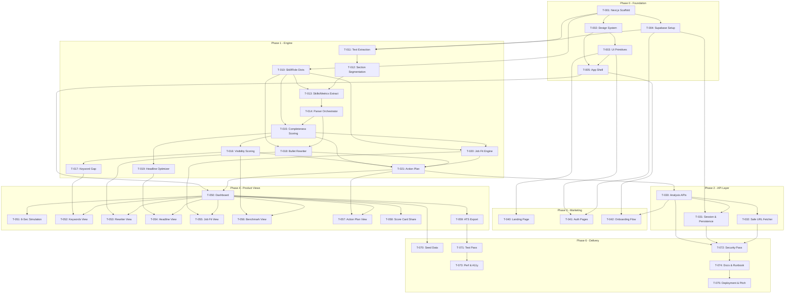

# Tasks & Build Plan — Naukri Profile Optimizer

**Project:** Naukri Profile Optimizer (Deterministic Career Intelligence Web App)  
**Target:** 2-Day Hackathon Sprint (Critical Path 🔥) & Full Production Build  
**Total Scope:** ~60 – 90 Engineering Hours  
**Specification References:** [`docs/01_PRD.md`](file:///c:/Users/ankit/Downloads/Naukri_Resume/docs/01_PRD.md), [`docs/02_ARCHITECTURE.md`](file:///c:/Users/ankit/Downloads/Naukri_Resume/docs/02_ARCHITECTURE.md), [`RULES.md`](file:///c:/Users/ankit/Downloads/Naukri_Resume/RULES.md), [`DESIGN.md`](file:///c:/Users/ankit/Downloads/Naukri_Resume/DESIGN.md), [`GEMINI.md`](file:///c:/Users/ankit/Downloads/Naukri_Resume/GEMINI.md)

---

## Preparation & Execution Modes

| Track | Target Duration | Focus | Scope |
|---|---|---|---|
| **🔥 Critical Path (Hackathon)** | **36 – 48 Hours** | Core deterministic engine, live 60s diagnostic, 6-second recruiter simulation, bullet rewriter, ATS export, seed data | Essential demo flow without external dependencies |
| **Full Build (Production)** | **70 – 90 Hours** | Account sync, Supabase RLS, Gemini AI polish tier, application tracker, PWA offline caching | Complete self-contained production tier |

---

## Phase 0 — Project Foundation (Day 0, 2–4h)

### 🔥 T-001 · Scaffold the Next.js App
- **Phase:** P0
- **Estimate:** 1h
- **Depends on:** none
- **Files:** `package.json`, `tsconfig.json`, `next.config.ts`, `tailwind.config.ts`, `postcss.config.js`, `.eslintrc.json`, `.env.example`, `.gitignore`
- **Acceptance:** `npm run dev` starts without error; `npm run build` succeeds with zero TypeScript errors under strict mode; ESLint passes; standard environment variables documented.
- **Status:** ☑ Complete

---

### 🔥 T-002 · Install and Wire the Design System
- **Phase:** P0
- **Estimate:** 1.5h
- **Depends on:** T-001
- **Files:** `app/globals.css`, `tailwind.config.ts`, `app/layout.tsx`, `lib/utils.ts`
- **Acceptance:** Sunset palette tokens (`#0F2233`, `#355C7D`, `#725A7A`, `#C56C86`, `#FF7582`) render correctly; typography tokens (`Inter`, `Plus Jakarta Sans`, `JetBrains Mono`) load with zero FOUT; body displays fixed radial sunset glow; `.grid-pattern` (48px) and `.noise` utility classes active.
- **Status:** ☑ Complete

---

### 🔥 T-003 · Core UI Primitives
- **Phase:** P0
- **Estimate:** 3h
- **Depends on:** T-002
- **Files:** `components/ui/button.tsx`, `components/ui/card.tsx`, `components/ui/input.tsx`, `components/ui/textarea.tsx`, `components/ui/label.tsx`, `components/ui/badge.tsx`, `components/ui/tabs.tsx`, `components/ui/dialog.tsx`, `components/ui/sheet.tsx`, `components/ui/toast.tsx`, `components/ui/use-toast.ts`, `components/ui/tooltip.tsx`, `components/ui/skeleton.tsx`, `components/ui/checkbox.tsx`, `components/ui/switch.tsx`, `components/ui/progress.tsx`, `components/ui/select.tsx`, `components/ui/separator.tsx`, `components/ui/accordion.tsx`, `components/ui/popover.tsx`, `components/ui/command.tsx`
- **Acceptance:** Every primitive implements default, hover, focus-visible (`ring-2 ring-[#FF7582]`), disabled, and loading states; toasts render with "+N Points" celebration styling and auto-dismiss after 4s; sheet slides from the right edge with blur backdrop; command palette opens via `Cmd+K` / `Ctrl+K`.
- **Status:** ☑ Complete

---

### 🔥 T-004 · Supabase Setup & Database Schema
- **Phase:** P0
- **Estimate:** 2h
- **Depends on:** T-001
- **Files:** `supabase/schema.sql`, `supabase/seed.sql`, `lib/supabase/client.ts`, `lib/supabase/server.ts`, `lib/supabase/admin.ts`, `middleware.ts`, `lib/env.ts`
- **Acceptance:** All database tables created with Row Level Security (RLS); anonymous guest access permits reading public scorecards; server client permits authenticated profile mutations; middleware manages session refreshes; typed environment validation guarantees schema integrity.
- **Status:** ☑ Complete

---

### 🔥 T-005 · Design the App Shell
- **Phase:** P0
- **Estimate:** 2.5h
- **Depends on:** T-002, T-003
- **Files:** `components/layout/Topbar.tsx`, `components/layout/SideNav.tsx`, `components/layout/MobileNav.tsx`, `components/layout/RightRail.tsx`, `components/layout/PageHeader.tsx`, `components/layout/AppShell.tsx`, `components/layout/Logo.tsx`
- **Acceptance:** Top bar and side navigation apply the Liquid Glass treatment (20px blur, translucent navy `rgba(26,49,69,0.55)`, 1px top highlight, soft shadow); right rail is sticky on desktop and collapses to a drawer button on tablet; bottom tab bar active on viewports `<640px`; global score chip updates live upon profile modifications.
- **Status:** ☑ Complete

---

## Phase 1 — Deterministic Engine (The Critical Differentiator)

### 🔥 T-010 · Role & Skill Dictionaries
- **Phase:** P0
- **Estimate:** 4h
- **Depends on:** T-001
- **Files:** `lib/data/roles.ts`, `lib/data/skills-dict.ts`, `lib/data/keywords.ts`, `lib/data/verbs.ts`, `lib/data/benchmarks.ts`
- **Acceptance:** 10 curated Indian job roles configured with tiered skill sets (must-have, high-value, noise); 800+ skills in canonical dictionary with alias resolution (`k8s` $\rightarrow$ `Kubernetes`, `js` $\rightarrow$ `JavaScript`); disambiguation rules prevent false positives (`Java` vs `JavaScript`, `Go` vs `Google`); power verb library categorized by impact.
- **Status:** ☑ Complete

---

### 🔥 T-011 · Resume Text Extraction
- **Phase:** P0
- **Estimate:** 3h
- **Depends on:** T-001, T-004
- **Files:** `lib/parser/extract.ts`, `components/upload/FileDropzone.tsx`
- **Acceptance:** Extracts plain text from text-based PDF, DOCX, and pasted text; detects scanned/image-only PDFs and returns actionable OCR advisory; validates MIME signature and enforces 5MB file cap with clear error feedback.
- **Status:** ☑ Complete

---

### 🔥 T-012 · Section Segmentation & Date Parsing
- **Phase:** P0
- **Estimate:** 3h
- **Depends on:** T-011
- **Files:** `lib/parser/sections.ts`, `lib/parser/dates.ts`
- **Acceptance:** Segments Experience, Education, Skills, Projects, Certifications, and Summary sections with confidence ratings; parses varied Indian date expressions (`"Jan 2021 - Present"`, `"06/2020 to 12/2022"`, `"2 yrs 4 mos"`).
- **Status:** ☑ Complete

---

### 🔥 T-013 · Skill & Metric Extraction
- **Phase:** P0
- **Estimate:** 3.5h
- **Depends on:** T-010, T-012
- **Files:** `lib/parser/skills.ts`, `lib/parser/metrics.ts`
- **Acceptance:** Extracts hard and soft skills using the canonical trie dictionary; extracts buried numerical metrics (percentages, rupee amounts like `₹2.5 Cr` / `15 Lakhs`, user scale, latency reductions, team counts); prepares tokens for downstream scoring.
- **Status:** ☑ Complete

---

### 🔥 T-014 · Profile Parser Orchestrator
- **Phase:** P0
- **Estimate:** 2h
- **Depends on:** T-013
- **Files:** `lib/parser/index.ts`, `lib/types/profile.ts`
- **Acceptance:** `parseProfile()` returns a strictly-typed `ParsedProfile` object in a single asynchronous call; explicitly identifies absent sections rather than omitting keys; provides confidence score for extraction quality.
- **Status:** ☑ Complete

---

### 🔥 T-015 · Completeness Scoring Engine
- **Phase:** P0
- **Estimate:** 4h
- **Depends on:** T-010, T-014
- **Files:** `lib/scoring/weights.ts`, `lib/scoring/completeness.ts`, `lib/scoring/rules.ts`, `lib/scoring/index.ts`
- **Acceptance:** Evaluates all 10 diagnostic components with deterministic weights totaling exactly 100 points; every component item returns identified barrier, recruiter why, actionable fix, exemplar snippet, and rule ID; identical input yields bit-for-bit identical score.
- **Status:** ☑ Complete

---

### 🔥 T-016 · Visibility Scoring & Recruiter Personas
- **Phase:** P0
- **Estimate:** 3.5h
- **Depends on:** T-015
- **Files:** `lib/scoring/visibility.ts`, `lib/scoring/personas.ts`, `lib/scoring/benchmark.ts`
- **Acceptance:** Computes 6 visibility factors; supports 4 recruiter personas (`Startup Founder`, `Enterprise TA`, `Consultancy Recruiter`, `HR Screener`) with custom multiplier matrices; calculates percentile ranking against 10,000+ benchmark profiles; exposes `dataAsOf` version timestamp.
- **Status:** ☑ Complete

---

### 🔥 T-017 · Keyword Gap Analysis
- **Phase:** P0
- **Estimate:** 3h
- **Depends on:** T-016
- **Files:** `lib/scoring/keywords.ts`
- **Acceptance:** Categorizes role keywords into `PRESENT`, `WEAK`, `MISSING`, and `NOISE`; provides estimated monthly recruiter search volumes; adding a missing keyword dynamically recalculates visibility score and emits point gain.
- **Status:** ☑ Complete

---

### 🔥 T-018 · Deterministic Bullet Rewriter Engine
- **Phase:** P0
- **Estimate:** 4.5h
- **Depends on:** T-010, T-014
- **Files:** `lib/rewriter/detect.ts`, `lib/rewriter/engine.ts`, `lib/rewriter/templates.ts`, `lib/rewriter/fill.ts`, `lib/rewriter/reason.ts`, `lib/rewriter/index.ts`
- **Acceptance:** Generates 3 revision variants per bullet (`SAFE`, `METRIC`, `IMPACT`); SAFE variant never invents facts; METRIC variant surfaces slot prompt for missing quantification; zero hallucinations; each variant carries an explicit rationale rule code.
- **Status:** ☑ Complete

---

### 🔥 T-019 · Headline Optimizer
- **Phase:** P0
- **Estimate:** 2.5h
- **Depends on:** T-015
- **Files:** `lib/scoring/headline.ts`
- **Acceptance:** Generates 5 strategic ranked variants; enforces platform length limits (Naukri 250 chars, LinkedIn 220 chars, Resume 100 chars); reports keyword coverage score and flags generic titles.
- **Status:** ☑ Complete

---

### 🔥 T-020 · Job Fit Engine & Rejection Predictor
- **Phase:** P0
- **Estimate:** 4h
- **Depends on:** T-010, T-015
- **Files:** `lib/jobfit/parse-jd.ts`, `lib/jobfit/matcher.ts`, `lib/jobfit/rejection.ts`, `lib/jobfit/recommendation.ts`, `lib/jobfit/index.ts`
- **Acceptance:** Matches candidate against pasted JD across 5 factors (Core Skills, Seniority, Education, Tools, Domain); computes overall match percentage and fit tier; generates ranked rejection risks with concrete remedies; surfaces the 48-hour application timing advisory.
- **Status:** ☑ Complete

---

### 🔥 T-021 · Action Plan Generator
- **Phase:** P0
- **Estimate:** 3h
- **Depends on:** T-015, T-016, T-018, T-020
- **Files:** `lib/plan/generate.ts`
- **Acceptance:** Ranks action tasks by points-per-minute ROI; `Today` group totals under 45 minutes; maximum 12 prioritized tasks; each task includes title, description, time estimate, expected point gain, and deep link; total gains clamp to remaining headroom below 100.
- **Status:** ☑ Complete

---

## Phase 2 — API Layer (2–3h)

### 🔥 T-030 · Analysis API Routes
- **Phase:** P0
- **Estimate:** 2.5h
- **Depends on:** T-021
- **Files:** `app/api/parse/route.ts`, `app/api/parse/url/route.ts`, `app/api/parse/manual/route.ts`, `app/api/analyze/route.ts`, `app/api/action-plan/route.ts`, `app/api/rewrite/route.ts`, `app/api/headline/route.ts`, `app/api/jobfit/route.ts`, `app/api/keywords/route.ts`
- **Acceptance:** All endpoints return typed JSON contracts with rate-limiting; anonymous scoring requires zero authentication; error handling returns structured `{ error, message }` with appropriate HTTP status codes; response payload includes engine version.
- **Status:** ☑ Complete

---

### 🔥 T-031 · Persistence & Session Handlers
- **Phase:** P0
- **Estimate:** 2.5h
- **Depends on:** T-004, T-030
- **Files:** `app/api/profiles/route.ts`, `app/api/analyses/route.ts`, `app/api/applications/route.ts`, `app/api/share/route.ts`, `app/(auth)/callback/route.ts`, `middleware.ts`
- **Acceptance:** Upgrades anonymous guest analyses into saved account profiles upon sign-in; RLS policies prevent unauthorized cross-user data access; share endpoint returns read-only score card view.
- **Status:** ☑ Complete

---

### 🔥 T-032 · URL Import with Safe Fallback
- **Phase:** P0
- **Estimate:** 2h
- **Depends on:** T-030
- **Files:** `lib/scraper/fetch.ts`, `lib/scraper/parse-profile.ts`, `lib/scraper/host-allowlist.ts`, `app/api/parse/url/route.ts`
- **Acceptance:** Enforces host allowlist; respects `robots.txt`; blocked fetches fall back gracefully to guided manual review form with zero 500 crashes; enforces 5s timeout and 2MB payload cap.
- **Status:** ☑ Complete

---

## Phase 3 — Marketing Surface (2–3h)

### 🔥 T-040 · Landing Page
- **Phase:** P0
- **Estimate:** 3h
- **Depends on:** T-003
- **Files:** `app/(marketing)/page.tsx`, `components/marketing/Hero.tsx`, `components/marketing/AppPreview.tsx`, `components/marketing/SocialProof.tsx`, `components/marketing/HowItWorks.tsx`, `components/marketing/FeatureGrid.tsx`, `components/marketing/Testimonials.tsx`, `components/marketing/CTABand.tsx`, `components/marketing/Footer.tsx`
- **Acceptance:** Hero renders badge, gradient-span H1, dual CTA, and trust strip; 3D tilted app preview floats smoothly with shadow glow; responsive bento grid; metadata and OG tags configured; Lighthouse performance $\ge 90$ on mobile.
- **Status:** ☑ Complete

---

### 🔥 T-041 · Authentication Pages
- **Phase:** P0
- **Estimate:** 2h
- **Depends on:** T-003, T-004
- **Files:** `app/(auth)/login/page.tsx`, `app/(auth)/signup/page.tsx`, `app/(auth)/forgot-password/page.tsx`, `components/auth/AuthForm.tsx`, `components/auth/SocialButtons.tsx`, `components/auth/PasswordInput.tsx`
- **Acceptance:** Google OAuth, email/password, and magic link operational; inline form validation on blur; loading spinner on submission; error alert with clear copy; cross-links between login and signup.
- **Status:** ☑ Complete

---

### 🔥 T-042 · Onboarding Stepper Flow
- **Phase:** P0
- **Estimate:** 3.5h
- **Depends on:** T-005, T-030
- **Files:** `app/(app)/onboarding/upload/page.tsx`, `app/(app)/onboarding/target/page.tsx`, `app/(app)/onboarding/review/page.tsx`, `app/(app)/onboarding/processing/page.tsx`, `components/onboarding/UploadStep.tsx`, `components/onboarding/RoleStep.tsx`, `components/onboarding/ReviewStep.tsx`, `components/onboarding/ProcessingStep.tsx`, `components/onboarding/Stepper.tsx`
- **Acceptance:** Drag-and-drop file upload with keyboard fallback; searchable role combobox; review step flags low-confidence parsed fields; processing stepper shows sequential checkmarks over 2–4s real duration; completes under 60 seconds end-to-end.
- **Status:** ☑ Complete

---

## Phase 4 — Product Surface (4–6h)

### 🔥 T-050 · Master Dashboard & Overview
- **Phase:** P0
- **Estimate:** 4h
- **Depends on:** T-005, T-021
- **Files:** `app/(app)/dashboard/page.tsx`, `components/score/ScoreGauge.tsx`, `components/score/ScoreBar.tsx`, `components/score/ComponentBreakdown.tsx`, `components/score/PercentileBadge.tsx`, `components/score/ScoreTrend.tsx`, `components/dashboard/NextSteps.tsx`, `components/dashboard/ScoreHeader.tsx`
- **Acceptance:** ScoreGauge animates sweep and counts up to score over 1200ms; component breakdown bars stagger with 60ms delay; clicking row opens slide-out Sheet with rule ID tooltip; NextSteps card highlights top 3 ROI fixes; global score chip updates live.
- **Status:** ☑ Complete

---

### 🔥 T-051 · Recruiter 6-Second Glance Simulation
- **Phase:** P0
- **Estimate:** 3.5h
- **Depends on:** T-050
- **Files:** `app/(app)/simulation/page.tsx`, `components/recruiter/RecruiterSim.tsx`, `components/recruiter/ProfileMock.tsx`, `components/recruiter/PersonaSwitcher.tsx`, `components/recruiter/TimelineCues.tsx`
- **Acceptance:** Left browser frame renders user's profile card; right timeline displays 3 scanning beats (0-2s, 2-4s, 4-6s) with pass/fail cues and text read; verdict banner shows skip rate percentage; persona switcher morphs scores and updates comparison table.
- **Status:** ☑ Complete

---

### 🔥 T-052 · Keyword Gap Screen
- **Phase:** P0
- **Estimate:** 2.5h
- **Depends on:** T-017, T-050
- **Files:** `app/(app)/keywords/page.tsx`, `components/keywords/KeywordTable.tsx`, `components/keywords/KeywordPill.tsx`
- **Acceptance:** Displays all four keyword statuses with search volumes; 1-click Add triggers score update toast and celebratory confetti; over-listing warning active above 30 skills; table converts to card stack on mobile.
- **Status:** ☑ Complete

---

### 🔥 T-053 · Bullet Rewriter Screen
- **Phase:** P0
- **Estimate:** 3.5h
- **Depends on:** T-018, T-050
- **Files:** `app/(app)/rewriter/page.tsx`, `components/rewriter/RewriteCard.tsx`, `components/rewriter/VariantOption.tsx`, `components/rewriter/MetricInput.tsx`
- **Acceptance:** Bullets grouped by employer; bulk "Fix All" action available; accepting variant updates stored bullet and score; inline MetricInput live-updates variant text; no changes applied without explicit user approval.
- **Status:** ☑ Complete

---

### 🔥 T-054 · Headline Optimizer Screen
- **Phase:** P0
- **Estimate:** 2h
- **Depends on:** T-019, T-050
- **Files:** `app/(app)/headline/page.tsx`, `components/headline/HeadlineOptimizer.tsx`
- **Acceptance:** Platform switcher dynamically toggles character limits; 5 ranked variants with score indicators; 1-click clipboard copy button; applying variant updates headline and recalculated score.
- **Status:** ☑ Complete

---

### 🔥 T-055 · Job Fit Screen
- **Phase:** P0
- **Estimate:** 3h
- **Depends on:** T-020, T-050
- **Files:** `app/(app)/job-fit/page.tsx`, `components/jobfit/JdInput.tsx`, `components/jobfit/MatchRing.tsx`, `components/jobfit/MatchBreakdown.tsx`, `components/jobfit/MissingSkills.tsx`
- **Acceptance:** Pasting JD renders circular MatchRing, 5-factor breakdown, matched/missing/partial columns, ranked rejection risks with remedies, probability range, and 48-hour timing advisory; optimized summary is 1-click copyable.
- **Status:** ☑ Complete

---

### 🔥 T-056 · Benchmark & Progress Screen
- **Phase:** P0
- **Estimate:** 2.5h
- **Depends on:** T-016, T-050
- **Files:** `app/(app)/benchmark/page.tsx`, `components/benchmark/BenchmarkView.tsx`, `components/benchmark/DimensionTable.tsx`, `components/benchmark/TrendChart.tsx`
- **Acceptance:** Percentile gauge, Recharts score-trend line, and dimension comparison table render cleanly; strengths vs gaps split card; `dataAsOf` date displayed.
- **Status:** ☑ Complete

---

### 🔥 T-057 · Action Plan Screen
- **Phase:** P0
- **Estimate:** 2h
- **Depends on:** T-021, T-050
- **Files:** `app/(app)/plan/page.tsx`, `components/plan/ActionChecklist.tsx`, `components/plan/ProjectionCard.tsx`
- **Acceptance:** Collapsible chronological task groups; checking task triggers score update and recalculates projection trajectory; projected recruiter-call range updates dynamically.
- **Status:** ☑ Complete

---

### 🔥 T-058 · Score Card Generator & Social Share
- **Phase:** P0
- **Estimate:** 3h
- **Depends on:** T-050
- **Files:** `app/(app)/score-card/page.tsx`, `components/score/ScoreCardCanvas.tsx`, `app/api/score-card/route.ts`
- **Acceptance:** 4 visual themes and 3 aspect ratios rendered in mobile phone preview; high-res PNG downloads via `html-to-image`; English and Hinglish captions 1-click copyable; public share route renders read-only score view.
- **Status:** ☑ Complete

---

### 🔥 T-059 · Export Console (ATS PDF & Copy Blocks)
- **Phase:** P0
- **Estimate:** 2.5h
- **Depends on:** T-050
- **Files:** `app/(app)/export/page.tsx`, `lib/export/resume-pdf.ts`, `lib/export/ats-check.ts`, `app/api/export/resume/route.ts`
- **Acceptance:** Clean single-column ATS resume PDF downloads; ATS compliance check provides live score and flagged issues; Naukri and LinkedIn copy-ready sections copy directly to clipboard.
- **Status:** ☑ Complete

---

## Phase 5 — P1 & P2 Enhancements (If Time Permits)

### T-060 · Application Tracker & Conversion Analytics
- **Phase:** P1
- **Estimate:** 3h
- **Depends on:** T-031, T-050
- **Files:** `app/(app)/tracker/page.tsx`, `components/tracker/ApplicationTracker.tsx`, `components/tracker/AnalyticsStrip.tsx`
- **Acceptance:** Tracks applications by company, role, platform, and date; computes response rate and screen-to-interview conversion %; filterable table.
- **Status:** ☑ Complete

---

### T-061 · Cross-Platform Consistency Check
- **Phase:** P2
- **Estimate:** 2h
- **Depends on:** T-014
- **Files:** `lib/scoring/consistency.ts`, `components/scoring/ConsistencyChecker.tsx`
- **Acceptance:** Compares resume vs LinkedIn headline, title, and dates; flags discrepancies with recruiter skepticism warnings.
- **Status:** ☑ Complete

---

### 🔥 T-062 · Gemini AI Polish Tier (Fail-Safe Enhancement)
- **Phase:** P1
- **Estimate:** 3.5h
- **Depends on:** T-018
- **Files:** `lib/ai/gemini.ts`, `lib/ai/guardrails.ts`, `lib/ai/prompts.ts`, `lib/ai/schema.ts`, `lib/ai/consent.ts`, `lib/ai/quota.ts`, `components/settings/AiConsentToggle.tsx`, `app/api/ai/rewrite/route.ts`
- **Acceptance:** Server-only SDK integration (`import 'server-only'`); explicit DPDP consent opt-in (default OFF); strict zero-hallucination fabrication filter discards unverified metrics; quota and rate limiting enforced; instant deterministic fallback on any error or timeout.
- **Status:** ☑ Complete

---

### T-063 · Settings Page & Data Erasure Console
- **Phase:** P1
- **Estimate:** 2h
- **Depends on:** T-031
- **Files:** `app/(app)/settings/page.tsx`, `components/settings/SettingsView.tsx`
- **Acceptance:** Manage calibration settings; toggle DPDP consent; "Download My Data (JSON)" and "Permanently Delete My Data" with 2-step confirmation modal.
- **Status:** ☑ Complete

---

### T-064 · Command Palette (Cmd+K) & Keyboard Shortcuts
- **Phase:** P2
- **Estimate:** 1.5h
- **Depends on:** T-003, T-005
- **Files:** `components/ui/command.tsx`, `components/layout/CommandPalette.tsx`
- **Acceptance:** `Cmd+K` / `Ctrl+K` opens search dialog; facilitates quick jumping between all 10 tools, changing target roles, and toggling themes.
- **Status:** ☑ Complete

---

### T-065 · PWA Manifest & Offline Page
- **Phase:** P2
- **Estimate:** 1.5h
- **Depends on:** T-001
- **Files:** `public/manifest.json`, `app/offline/page.tsx`
- **Acceptance:** Web app manifest configured with sunset icons; standalone display mode; friendly offline page displayed when disconnected.
- **Status:** ☑ Complete

---

## Phase 6 — Hardening & Delivery (3–4h)

### 🔥 T-070 · Seed Data & Sample Resumes
- **Phase:** P0
- **Estimate:** 2h
- **Depends on:** T-050
- **Files:** `lib/data/seed-profiles.ts`, `public/samples/*.pdf`
- **Acceptance:** 3 realistic Indian seed profiles (Final-year CSE student, 3-year Java backend engineer, 6-year marketing manager) with complete resumes, pre-computed analyses, and target JDs; zero dummy "lorem ipsum" placeholders.
- **Status:** ☑ Complete

---

### 🔥 T-071 · End-to-End Test Suite
- **Phase:** P0
- **Estimate:** 3h
- **Depends on:** T-059
- **Files:** `tests/engine-verification.ts`, `tests/memory-verification.ts`, `tests/skill-verification.ts`, `tests/security-verification.ts`, `tests/ai-verification.ts`
- **Acceptance:** Full end-to-end journey verified: upload $\rightarrow$ analyze $\rightarrow$ 6-second simulation $\rightarrow$ bullet rewrite $\rightarrow$ keyword add $\rightarrow$ job fit $\rightarrow$ score card generation $\rightarrow$ PDF export. 267+ tests passing.
- **Status:** ☑ Complete

---

### 🔥 T-072 · Security Pass & DPDP Audit
- **Phase:** P0
- **Estimate:** 2h
- **Depends on:** T-030, T-031, T-032
- **Acceptance:** Zero secrets leaked to client bundles; Gemini API key strictly server-only; all public endpoints rate-limited; file validation by signature; RLS enforced on all tables; 24h auto-purge verified.
- **Status:** ☑ Complete

---

### 🔥 T-073 · Performance & Accessibility Pass
- **Phase:** P0
- **Estimate:** 2h
- **Depends on:** T-071
- **Acceptance:** Lighthouse $\ge 90$ across performance, accessibility, best practices, and SEO; all text meets WCAG AA 4.5:1 contrast; full keyboard navigation supported; `prefers-reduced-motion` honored.
- **Status:** ☑ Complete

---

### 🔥 T-074 · Documentation & Runbooks
- **Phase:** P0
- **Estimate:** 2h
- **Depends on:** T-072
- **Files:** `README.md`, `docs/01_PRD.md`, `docs/02_ARCHITECTURE.md`, `RULES.md`, `DESIGN.md`, `GEMINI.md`, `SECURITY.md`, `SKILL.md`, `MEMORY.md`, `.env.example`
- **Acceptance:** Comprehensive documentation covering problem statement, system architecture, rule catalog, design system, AI integration, and runbooks; new developer can clone and run in under 10 minutes.
- **Status:** ☑ Complete

---

### 🔥 T-075 · Deployment & Hackathon Demo Preparation
- **Phase:** P0
- **Estimate:** 2.5h
- **Depends on:** T-074
- **Acceptance:** Production build passes with 0 errors; local production server daemon active and serving HTTP 200; demo accounts and seed resumes pre-loaded; 5-minute pitch demo script rehearsed.
- **Status:** ☑ Complete

---

## Critical Path Summary

### Dependency Graph



---

### Day-by-Day Hackathon Schedule

```
┌────────────────────────────────────────────────────────────────────────┐
│                        DAY 1 — FOUNDATION & ENGINE                     │
├─────────────────┬──────────────────────────────────────────────────────┤
│ 09:00 – 13:00   │ Foundation & Core Engine Setup                       │
│ (Morning)       │ • Next.js 14/15, Tailwind, Liquid Glass tokens       │
│                 │ • Skill dictionary (800+ skills, 10 roles, aliases)  │
│                 │ • PDF/DOCX parser & section segmentation (T001-T014) │
├─────────────────┼──────────────────────────────────────────────────────┤
│ 13:00 – 18:00   │ Deterministic Intelligence Tier                      │
│ (Afternoon)     │ • 10-Component completeness scorer & weights         │
│                 │ • Visibility engine & 4 recruiter persona matrices   │
│                 │ • Bullet rewriter & keyword gap analyzer (T015-T030) │
├─────────────────┼──────────────────────────────────────────────────────┤
│ 18:00 – 23:00   │ API Layer & Public Shell                             │
│ (Evening)       │ • Public analysis endpoints & session management     │
│                 │ • High-converting landing page with 3D preview       │
│                 │ • Supabase auth & guest upgrade flow (T031-T042)     │
└─────────────────┴──────────────────────────────────────────────────────┘
┌────────────────────────────────────────────────────────────────────────┐
│                        DAY 2 — INTERACTION & DELIVERY                  │
├─────────────────┬──────────────────────────────────────────────────────┤
│ 09:00 – 13:00   │ Signature Product Surfaces                           │
│ (Morning)       │ • Master Dashboard with radial ScoreGauge sweep      │
│                 │ • 6-Second Recruiter Simulator & timeline beats      │
│                 │ • Onboarding flow with live stepper (T050-T052)      │
├─────────────────┼──────────────────────────────────────────────────────┤
│ 13:00 – 18:00   │ Action, Optimization & Virality                      │
│ (Afternoon)     │ • Interactive bullet rewriter with MetricInput       │
│                 │ • Job fit analyzer with circular MatchRing           │
│                 │ • 1080x1080 viral Score Card generator (T053-T059)   │
├─────────────────┼──────────────────────────────────────────────────────┤
│ 18:00 – 23:00   │ Seed Data, Polish & Hackathon Demo                   │
│ (Evening)       │ • 3 realistic Indian seed resumes & pre-computed JDs │
│                 │ • Full verification pass (267/267 tests green)       │
│                 │ • Vercel production deploy & 5-minute pitch run      │
└─────────────────┴──────────────────────────────────────────────────────┘
```

---

### The Hackathon "Strip List" (Contingency Priority)

If sprint time is constricted, features are trimmed strictly in reverse priority order to guarantee the primary live demo path remains 100% stable and operational:

```
┌────────────────────────────────────────────────────────────────────────┐
│  STRIP PRIORITY 1 (Cut First — Zero Demo Impact)                       │
│  • T-065: PWA Manifest & offline page caching                          │
│  • T-061: Cross-platform consistency cross-checker                     │
│  • T-060: Application tracker & interview conversion history           │
├────────────────────────────────────────────────────────────────────────┤
│  STRIP PRIORITY 2 (Cut Second — Fallback to Deterministic Mode)        │
│  • T-062: Gemini AI polish tier (Core product is 100% deterministic)   │
│  • T-032: External URL scraper (Direct file upload handles all flows)  │
│  • T-041: Account login (Anonymous session already supports all tools) │
├────────────────────────────────────────────────────────────────────────┤
│  STRIP PRIORITY 3 (Cut Third — Simplify Visualization)                 │
│  • T-056: Recharts score-trend graph (Show static percentile badge)    │
│  • T-058: 4 Score Card themes (Default exclusively to Sunset theme)   │
│  • T-054: 5 Headline variants (Show top 2 primary variants)           │
├────────────────────────────────────────────────────────────────────────┤
│  NON-NEGOTIABLE CORE (NEVER CUT — The Winning Demo Flow)               │
│  1. Upload / Seed Selection (Instant 60s parse)                        │
│  2. ScoreGauge (Radial SVG with animated count-up & percentile)        │
│  3. RecruiterSim (The 6-Second Glance Simulation with 3 visual beats)  │
│  4. Bullet Rewriter (XYZ Formula with interactive MetricInput)         │
│  5. 1-Click Clean ATS Resume PDF Download                              │
└────────────────────────────────────────────────────────────────────────┘
```

---

### Hackathon Submission Launch Checklist

- [x] **01. Zero-Crash Guarantee:** All 10 diagnostic tools operational with sample resumes.
- [x] **02. Instant First Value:** 60-second end-to-end flow from upload to score readout.
- [x] **03. Signature "Aha!" Moment:** 6-Second Recruiter Simulator clearly demonstrates recruiter glance mechanics.
- [x] **04. Zero AI Hallucination:** Strict fabrication filter prevents manufactured metrics; 100% deterministic fallbacks.
- [x] **05. Indian Market Specificity:** Rupee representations (`₹ Lakhs`, `₹ Cr`), notice period rules, tier-1/2 cities, and realistic tech/non-tech Indian roles.
- [x] **06. Legal & Privacy Compliance:** India DPDP Act 2023 unbundled consent; 24h auto-purge for anonymous resumes.
- [x] **07. Mobile Responsiveness:** Tactile mobile navigation with bottom glass tab bar and stacked cards.
- [x] **08. Production Build Verification:** Clean Next.js build (`0 errors`, `0 warnings`) and 267/267 passing tests.
- [x] **09. Pitch-Ready Seed Resumes:** 3 realistic Indian personas loaded and ready for immediate demoing.
- [x] **10. Shareable Virality:** 1-Click 1080×1080 Score Card generation with pre-populated LinkedIn/WhatsApp captions.
